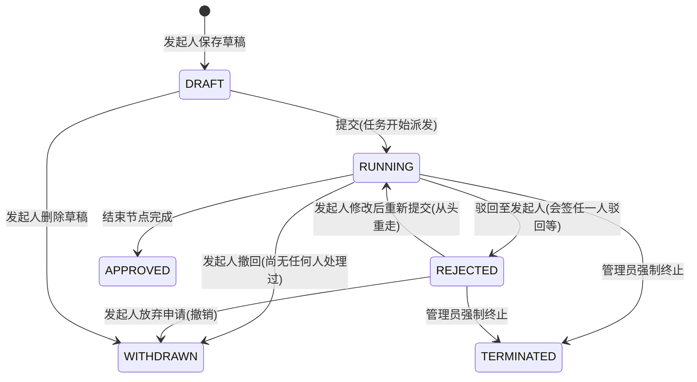

# 低代码表单 + 审批流平台 PRD（V1）

> 平台暂定名：**FlowForm**（可改）
> 版本：v0.1（草案） ｜ 状态：待评审 ｜ 面向读者：产品 / 研发 / 评审人
> 本文档确认后，将进入技术设计阶段，再开始编码。

---

## 0. 一句话简介

面向**单组织内部**使用的低代码平台：业务人员可以**快速配置表单模板**和**审批流程**，发起人填表提交后，系统按流程自动流转，支持**顺序审批、并行会签、或签、条件分支、动态审批人、驳回重提、抄送**；同时支持**按节点控制字段可见/可编辑权限**，让审批过程中表单数据（字段）逐节点丰富，最终沉淀为完整的业务单据，全程留痕可审计。

---

## 1. 背景与目标

### 1.1 背景

企业大量日常审批（请假、报销、用章、采购、合同等）流程相似但表单各异。用传统开发逐个做成本高、周期长；购买商业 OA/低代码 SaaS 存在成本与定制问题。因此自建一个轻量低代码平台，让管理员/设计者自助配置表单与流程，普通用户在线发起与审批。

### 1.2 目标（V1）

1. **表单可配置**：无代码（表单化配置）定义表单字段、校验、分区、明细子表。
2. **流程可编排**：无代码配置审批链，覆盖顺序/并行会签/或签/条件分支/动态审批人/抄送/驳回退回等主流语义。
3. **字段随审批累积**：审批过程中不同节点看到/编辑不同字段，支持补充填写与运行中追加字段，实例数据逐步完整。
4. **开箱即闭环**：内置用户/部门/角色管理与待办工作台，可直接在内部使用。
5. **简单可靠**：单组织 ≤ 1k 用户规模，引擎自研、语义清晰可控，全流程留痕。

### 1.3 非目标（V1 明确不做）

- 多租户 / SaaS 计费 / 开通管理；
- 可视化流程图拖拽画布（**V2**，同一份流程模型 JSON）；
- 与钉钉/企微/邮件等外部通知集成（先做站内）；
- BPMN 全标准（如子流程、边界事件、定时触发、多实例循环等）；
- 移动端原生 App（桌面 Web 优先，页面做基础自适应）；
- 复杂报表/BI、跨实例表单数据聚合、数据大屏。

---

## 2. 用户与角色

| 角色 | 说明 | 核心权限 |
|---|---|---|
| 平台管理员 | 内置初始化账号，管理组织与全局设置 | 组织管理、一切实例可见、终止任意流程、停用模板/流程 |
| 设计者 | 由管理员授予（可同时是普通用户） | 新建/发布/停用**表单模板**与**流程模板**；可查看自己发起的实例；不可查看全量实例或他人审批数据；实例管理仅管理员；无审批数据管理权 |
| 普通用户 | 全体账号 | 在授权范围内发起流程、处理分配到的审批/填写任务、查看自己相关的实例 |

补充规则：

- 角色设计：全局角色（如“部门主管”“财务”“总经理”），用于审批人解析与发起范围控制，不追求细粒度数据权限。
- 可发起范围：每个流程模板可配置“谁可以发起”（全员 / 指定角色 / 指定部门）。
- 实例可见性：发起人、该实例历任/现任处理人、被抄送人、平台管理员可见详情；其他人不可见（部门级数据权限留待 V2）。

---

## 3. 领域模型与核心机制（最重要的部分）

### 3.1 三层对象

```
┌─────────────────────────── 定义层（模板，可配置、可发版） ───────────────────────────┐
│  表单模板 FormTemplate（含版本：字段 Schema）                                          │
│  流程模板 FlowTemplate（含版本：节点 + 字段权限矩阵 + 条件 + 审批人规则）               │
└────────────────────────────────────────────────────────────────────────────────────┘
                                │ 发起（绑定模板版本快照）
┌─────────────────────────── 实例层（一次业务办理） ───────────────────────────────────┐
│  流程实例 FlowInstance（表单数据 + 动态追加字段 + 当前状态 + 快照/历史）                │
└────────────────────────────────────────────────────────────────────────────────────┘
                                │ 引擎按流程定义推进
┌─────────────────────────── 任务层（人机交互点） ─────────────────────────────────────┐
│  任务 Task（审批任务 / 填写任务 / 抄送知会；并行时多个任务并发存在）                    │
└────────────────────────────────────────────────────────────────────────────────────┘
```

- **表单模板**：定义“长什么样、能填什么”。
- **流程模板**：定义“走几步、谁来处理、每一步能看/能改哪些字段、按什么条件走哪条路”。
- **两者各自版本化**：发布流程版本时**锁定所引用的表单版本**；流程实例运行期间，模板改版**不影响**已有实例。

### 3.2 表单模型（表单模板）

#### 3.2.1 结构

```
表单模板 = 模板信息(名称/图标/分组/说明)
        + 若干分区 Section（=“阶段区域”，如：申请信息区 / 审批补充区 / 归档信息区）
        + 分区内若干字段 Field
```

- 字段属于且仅属于一个分区；分区有**阶段标签**（发起 / 审批 / 补充 / 归档，可自定义名称），用于“分阶段表单区”的展示组织。
- Schema 以 JSON 存储（MySQL JSON 列），由后端统一做结构校验。

#### 3.2.2 控件清单（V1 全量，含优先级）

| 分组 | 控件 | V1 优先级 | 说明 |
|---|---|---|---|
| 基础 | 单行文本 / 多行文本 / 数字 / 单选 / 复选 / 下拉 / 日期 / 时间 / 日期时间 / 开关 | P0 | 必选基础集 |
| 组织 | 人员选择（单选/多选） / 部门选择 | P0 | 值可用于“动态审批人”解析 |
| 文件 | 附件上传 / 图片上传 | P0 | 存本地磁盘或对象存储，DB 记元数据 |
| 子表 | 明细子表（可增删行，行内嵌基础控件） | P0 | 如费用明细、物品清单 |
| 增强 | 自动计算字段（公式）、级联下拉 | P1 | 公式仅基础子集：数字四则、子表金额合计、日期差=天数、文本拼接；完整表达式后置 |

- 公共字段能力：标签、是否必填、占位/提示、默认值、校验（长度/范围/正则）、控件专属选项（如下拉选项 JSON）。
- **字段默认语义**：字段在“发起阶段”默认可编辑；在后续节点默认**只读**；**某个节点专属的补充字段默认对其他节点隐藏**，由流程节点的字段权限矩阵显式打开（见 3.4）。

### 3.3 流程模型（流程模板，V1 为结构化配置）

#### 3.3.1 配置形态

V1：**表单化/清单化配置**——在界面上按顺序维护节点列表，节点属性面板化编辑（不做画布连线）；V2 再加可视化画布，两种形态编辑**同一份流程模型 JSON**。

#### 3.3.2 节点类型

| 节点类型 | 动作 | 语义 |
|---|---|---|
| 审批节点 | 同意 / 驳回（到发起人）/ 退回（到指定节点） | 按审批人模式执行 |
| 填写节点 | 提交 / 退回 | 只补充填写该节点开放字段，无“同意/驳回”概念（如 HR 录档案号） |
| 并行组节点 | —— | 容器：组内为多个审批/填写节点**同时发起**，聚合模式见 3.5.3 |
| 条件分支节点 | —— | 按表单值条件选择走哪一个分支（分支内可再嵌套任意节点，分支结束自动汇合回主线，V1 不需要通用汇合节点） |
| 抄送节点 | 无（只读知会） | 生成“抄送给我”，可标记已读；**不阻塞主线** |
| 结束节点 | —— | 实例通过，状态机进入 APPROVED（流程定义末尾隐含，可显式配置） |

审批节点内部还需配置：

1. **审批人模式**：
   - 单人（唯一审批人）；
   - 多人依次（同节点内按序依次审批，全部通过才过）；
   - 并行会签（all）：同时发给多人，**全部同意**才通过；
   - 并行或签（any）：同时发给多人，**任一同意**即通过，其余任务自动取消。
2. **审批人来源（动态审批人）**，支持组合与“未命中”策略：

| 来源 | 解析方式 | 举例 |
|---|---|---|
| 指定人员 | 直接选人 | 张三 |
| 指定角色 | 角色下全部/按需 | 角色“财务” |
| 部门主管 | 发起人当前部门设置的主管人；本部门无主管时沿部门树向上找最近主管；仍无则转平台管理员并标记异常 | 直属上级（V1 用部门主管近似；有上级链数据再精确到直属上级；主管角色不作为派单来源） |
| 表单人员字段 | 取某人员/部门控件当前值 | “申请人上级”字段 |
| 发起人指定 | 提交时由发起人从候选范围里选 | 候补审批人 |
| 上一节点处理人（V1 可选） | 上一节点同意者 | 逐级审批 |

   - 解析**时机**：任务进入该节点时实时解析并**快照写入任务**（组织调整不影响已生成任务）；未命中任何审批人 → 默认转交平台管理员并标记异常，不静默通过。
   - 部门主管以部门主管人（`manager_user_id`）为准；无主管时沿部门树向上找，根部门仍无则转管理员并标记异常；不按“主管”角色的全部成员派单。

#### 3.3.3 结构化配置示例（报销单）

```jsonc
{
  "flowName": "费用报销",
  "formVersion": 3,
  "steps": [
    { "id": "s1", "type": "approval", "name": "部门经理审批",
      "approver": { "source": "department-manager", "deptField": "applyDept" },
      "fieldsPermission": { "base": "readonly", "overrides": { "amount>2000": "readonly" } } },
    { "id": "s2", "type": "condition", "name": "按金额分流",
      "branches": [
        { "id": "s2a", "when": "amount > 2000", "steps": [
            { "id": "s3", "type": "parallel", "name": "财务双签(会签)",
              "mode": "all",
              "members": [ { "type": "approval", "approver": { "source": "role", "role": "财务A岗" }, "name": "会计审批" },
                           { "type": "approval", "approver": { "source": "role", "role": "财务B岗" }, "name": "复核审批" } ] } ] },
        { "id": "s2b", "when": "else", "steps": [] }
      ] },
    { "id": "s4", "type": "fill", "name": "财务补充核销信息",
      "fieldsPermission": { "base": "hidden", "overrides": { "actualAmount": "editable-required", "invoiceNo": "editable" } } },
    { "id": "s5", "type": "cc", "name": "抄送财务总监", "ccTo": { "source": "role", "role": "财务总监" } }
  ]
}
```

> 字段权限、条件、审批人规则均结构化存储，引擎按 JSON 执行，V2 画布只是“另一种编辑器”。

### 3.4 字段累积机制（本平台差异化核心）

“审批过程中不断丰富表单字段”由三个机制组合实现：

#### 机制 A：节点级字段权限矩阵（P0）

每个流程节点配一张字段权限表：对模板内每个字段（含明细子表、文件）可取三种模式之一：

| 模式 | 效果 |
|---|---|
| `hidden` 隐藏 | 该节点及此后看不到（用于“还没到时间揭晓”的补充字段，如财务的“实际可报销金额”在申请阶段完全不可见） |
| `readonly` 只读 | 可见、不可改（默认值，审批人以此核验） |
| `editable` 可编辑 | 可见且可改；可叠加 `required` 必填与校验 |

- 配置端提供：按分区批量设模板（如“申请信息区=readonly；补充区=hidden”），再对个别字段做覆盖；
- **发起**=流程入口节点，编辑集 = 默认发起可编辑字段；
- 字段数据**逐节点累积**：任何人一旦写入，即刻成为实例数据的一部分，其后节点均可见（除非被配置 hidden）；
- 实例详情页按“分区 → 字段”渲染，同一份数据对不同角色呈现不同视图；
- 每次写入都带 `sourceNode` + 时间戳 + 操作人，可追溯。

#### 机制 B：分阶段表单区（P0，由 A 支撑）

- 表单模板用**分区**组织字段并打阶段标签（申请区 / 审批区 / 补充区 / 归档区）；
- 流程节点可对整个分区做权限模板设置，界面按当前节点的可见/可编辑状态**动态渲染分区**——发起人只看到申请区，财务节点看到申请区(只读)+补充区(可编辑)，终审后全量归档展示。

#### 机制 C：运行中动态追加字段（P1→P2 排期，需谨慎设计）

- 场景：流程跑到一半，需要临时增加一个字段（如补充“合同编号”）。
- 能力：平台管理员（或实例配置的设计者）在**该实例详情页**执行“追加字段”：选择控件、命名、指定**可编辑节点**（默认：当前待办节点）与必填性；
- 效果：动态字段只作用于**该实例**（不入模板），自动加入该实例 schema 与后续快照；对当前及后续节点可见（默认只读，仅目标节点可编辑）；
- 约束：追加后不允许删除（可停用/隐藏）；实例正常结束、归档后不可再追加；为控制复杂度，动态字段仅支持基础控件（文本/数字/日期/下拉/附件），不支持子表/公式；
- 追加行为本身写入审计历史。

> 实现提示：实例数据 = 模板 schema 值 + 实例扩展字段定义 + 扩展字段值，三者同版本快照存储。

### 3.5 引擎模型：顶层状态机 + 节点级令牌（并行怎么管）

> **为什么不能只用状态机**：经典状态机的状态是“单一快照”，天然无法表达“财务 A 与财务 B 两个审批任务同时挂起、各自独立完成”。因此采用**双层模型**：

```
┌─ 顶层：实例生命周期状态机（用户可感知的业务状态，简单直观）
└─ 底层：节点执行器 + 并行令牌（Task Token）——每个待办任务即一个活跃令牌，
        引擎以“事件 → 推进”驱动，支持任意并行；顶层状态由活跃令牌集合投影得出
```

#### 3.5.1 顶层生命周期状态机



| 状态 | 含义 | 可执行动作 |
|---|---|---|
| DRAFT | 草稿（发起中未提交） | 编辑/删除/提交 |
| RUNNING | 审批中（含并行多任务、退回节点重派） | 处理任务；满足条件时撤回；管理员终止 |
| REJECTED | 已驳回（等发起人重填或放弃） | 重新提交（重走全流程）/ 撤销 |
| APPROVED | 已通过（归档） | 查看 |
| WITHDRAWN | 已撤回/撤销 | 查看 |
| TERMINATED | 已终止 | 查看 |

- **退回指定节点 ≠ 驳回发起人**：实例仍处 RUNNING，引擎取消后续令牌，重新在目标节点派发任务（已通过的更早节点不重走，数据保留）。
- 重新提交轮次（第 1/2/3…轮）在实例上记录。

#### 3.5.2 任务与处理规则

- 每次“进入节点”生成任务（Task）；审批人为多人并行时，同一节点按“每人一条子任务”派发，聚合后整体算一个节点完成。
- 处理动作（均要求幂等，防重复点击/并发提交，DB 乐观锁 + 唯一约束）：
  - 审批节点：`同意` / `驳回到发起人` / `退回指定节点`（退回目标在流程定义上预配置，默认逐级向上可选）；
  - 填写节点：`提交` / `退回`；
  - 抄送：无动作（记录已读时间）。
- 动作携带：意见文本、附件、被修改字段明细（自动 diff）。

#### 3.5.3 并行聚合语义

| 场景 | 规则 |
|---|---|
| 会签 all（财务双签） | 全部子任务同意 → 节点通过继续；**任一子任务驳回** → 组失败，取消其余子任务，按驳回策略处理整实例；任一子任务**退回** → 按 §3.5.4 取消整个并行组及后续令牌，实例保持 RUNNING，在退回目标节点重派 |
| 或签 any | 任一子任务同意 → 节点通过，**自动取消其余子任务**（被取消人收到“无需处理”知会）；任一子任务先驳回 → 组失败 |
| 并行组内有人撤回触发 | 若实例整体满足撤回条件，取消组内全部子任务 |
| 抄送 | 不占令牌、不计入进度，主线不等 |

- 并发写冲突：同一时刻多任务修改不同字段 → 各自 diff 合并落库；修改同一字段以动作时间序后者覆盖，历史快照均保留（可对账）。
- 并行组内任一成员执行“退回”时，不按组失败处理：取消整个并行组及后续令牌，实例保持 RUNNING，在退回目标节点重派（D-03）。

#### 3.5.4 驳回 / 退回 / 撤回 / 终止总表

| 操作 | 谁 | 效果 | 补充 |
|---|---|---|---|
| 驳回 | 审批节点处理人 | 实例 → REJECTED，任务全取消；发起人可见“驳回意见与需修改字段”，修改后可**重新提交 → 从头重走** | 也可配置“驳回至发起人且不允许再提”（废弃） |
| 退回 | 审批/填写节点处理人 | 实例仍 RUNNING；取消被退回节点及后续全部令牌，在退回目标节点重新派任务；字段数据保留 | 退回目标：流程定义预配置的“前序节点集合”，默认支持退回上一级 |
| 撤回 | 发起人 | 实例 → WITHDRAWN，任务全取消 | 条件：**尚无任何任务被处理过**（避免处理到一半被撤造成混乱）；V2 再放开到“未处理节点可部分撤回” |
| 终止 | 平台管理员 | 实例 → TERMINATED，任务全取消 | 任意状态（除终态）可用；需填写原因，写入审计 |
| 撤销 | 发起人 | REJECTED → WITHDRAWN | 放弃本轮申请 |

### 3.6 快照与审计

- 每次任务动作后记录：动作、操作人、时间、节点、意见、**字段变更 diff**、附件；
- 实例详情“处理历史”按时间线展示，可切换查看每个历史时点的**数据快照**（版本化，供核对/争议追溯）；
- 模板/流程的每次修改与发布都记录版本与操作人，可回看历史版本定义。

---

## 4. 功能需求详述

优先级约定：P0 = V1 必须 ｜ P1 = V1 争取（按里程碑排期） ｜ P2 = V2+。

### F1 表单模板与表单化“设计器”

| 编号 | 需求 | 优先级 | 验收要点 |
|---|---|---|---|
| F1.1 | 模板列表/搜索/分组/启用停用；新建向导（名称+图标+分区规划） | P0 | 可建多个模板互不影响 |
| F1.2 | 字段配置：控件类型 + 公共属性 + 校验 + 选项，实时列表编辑，支持拖拽排序、移动分区 | P0 | 配置完成即可在前台正确渲染 |
| F1.3 | 分区管理（新增/重命名/阶段标签/排序），分区内字段归属 | P0 | 详情页按分区渲染 |
| F1.4 | 预览（发起人视角编辑态 / 审批人视角只读态） | P0 | 所见即所得 |
| F1.5 | 版本管理：草稿编辑 → 发布成新版本；被流程引用的版本不可物理删除 | P0 | 已有实例按锁定版本展示 |
| F1.6 | 明细子表编辑（行内字段组、增删行、行级必填） | P0 | 发起可增删行，审批只读 |
| F1.7 | 公式字段（基础子集：四则/子表合计/日期差/拼接）与级联下拉配置 | P1 | 表单提交与服务端重算一致 |
| F1.8 | 模板复制、导入导出 JSON | P1 | 便于复用迁移 |

### F2 流程模板与流程配置器

| 编号 | 需求 | 优先级 | 验收要点 |
|---|---|---|---|
| F2.1 | 流程列表/新建/绑定表单模板/启用停用；**结构化配置界面**：节点清单式维护 | P0 | 按 3.3.2 全部节点类型可配置 |
| F2.2 | 节点属性面板：审批人模式、审批人来源规则、驳回/退回目标、超时设置(占位) | P0 | 见 3.3.2 |
| F2.3 | **字段权限矩阵配置**：节点 × 字段 = hidden/readonly/editable(+required)，支持按分区批量 + 单字段覆盖，冲突提示 | P0 | 3.4 机制 A/B 可完整配置 |
| F2.4 | 条件分支配置：可视化条件编辑器（字段/比较符/值，支持 and/or 组合）+ 分支内嵌套节点编辑 + 未命中分支(else) | P0 | 条件只读展示在实例详情 |
| F2.5 | 发起范围配置（全员/角色/部门） | P0 | 非授权用户看不到发起入口 |
| F2.6 | 流程版本管理与发布（发布时锁定表单版本）；编辑未发布流程不影响运行中实例 | P0 | 运行中实例不受影响 |
| F2.7 | 流程校验器：保存/发布前静态检查（孤儿节点、无审批人配置、字段权限引用不存在字段、分支条件字段被删等） | P0 | 非法定义不可发布 |
| F2.8 | 流程复制、示例流程库（请假/报销） | P1 | 开箱即用两条 demo |

### F3 发起与填写（发起人视角）

| 编号 | 需求 | 优先级 | 验收要点 |
|---|---|---|---|
| F3.1 | 发起中心：可发起流程列表（按权限过滤）、入口选择“对应表单 + 流程” | P0 | — |
| F3.2 | 发起填写页：按“发起阶段分区”动态渲染，支持公式/子表/附件/人员部门选择；前端校验 + 后端二次校验 | P0 | 发起阶段看不到 hidden 补充字段 |
| F3.3 | 草稿：自动暂存、草稿箱列表、恢复编辑 | P0 | 草稿不生成审批任务 |
| F3.4 | 提交（可携带说明/附件），进入 RUNNING 并派发首个节点任务 | P0 | — |
| F3.5 | 发起时若流程含“发起人指定审批人”节点 → 提交前先选人 | P0 | 规则见 3.3.2 |
| F3.6 | 驳回后“重新提交”：展示驳回意见与历史快照对照，允许仅改可编辑字段（与首轮一致），再提交重走全流程 | P0 | 轮次递增、旧快照可查 |

### F4 审批工作台（处理人视角）

| 编号 | 需求 | 优先级 | 验收要点 |
|---|---|---|---|
| F4.1 | 工作台：待办（含会签“同时待我处理”的组提示）/ 已办 / 我发起的 / 抄送给我，支持筛选（类型、时间、关键词）与分页 | P0 | 会签组待办合并展示、分别操作 |
| F4.2 | 实例详情页：顶部流程进度条（当前节点高亮、并行组内子节点并列显示）；中部按当前任务权限渲染的分区表单；底部处理历史时间线 | P0 | 3.4 的三种机制在同一页面生效 |
| F4.3 | 处理操作区：同意 / 驳回(发起人) / 退回(可选目标)；填写节点为 提交/退回；意见、附件必填可配置；**可编辑字段修改留 diff** | P0 | 并发/重复提交幂等 |
| F4.4 | 处理时新增文件到“补充附件”区 | P0 | — |
| F4.5 | 或签被取消、实例被驳回/终止/撤回时，相关人员收到知会并在待办移除 | P0 | 状态同步无脏数据 |
| F4.6 | 历史数据快照查看（某时间点表单长什么样）、字段变更对照（旧值→新值） | P1 | — |

### F5 字段累积与动态扩展（管理员/设计者视角，落在实例上）

| 编号 | 需求 | 优先级 | 验收要点 |
|---|---|---|---|
| F5.1 | 实例详情（管理员/设计者）：“追加字段”入口 → 选控件/命名/指定可编辑节点/必填 → 生效 | P1(按 M5 排期) | 仅该实例生效 |
| F5.2 | 追加字段生效后：后续节点可见性/编辑权按配置生效；写入进快照；实例页标识“扩展字段”来源 | P1 | — |
| F5.3 | 追加字段停用/隐藏（不可物理删除） | P1 | — |
| F5.4 | 模板“补充字段”设计指引：新字段默认标记为指定节点补充（hidden 于发起阶段） | P0 | 融入 F1/F2 配置 |

### F6 组织与权限（管理员视角）

| 编号 | 需求 | 优先级 | 验收要点 |
|---|---|---|---|
| F6.1 | 用户管理：增删改查、启用/停用、重置密码、导入 CSV | P0 | — |
| F6.2 | 部门管理：树形结构、成员维护、主管角色标记 | P0 | 支撑“部门主管”解析 |
| F6.3 | 角色管理：内置（管理员/设计者/部门主管/财务…）+ 自定义；成员维护 | P0 | — |
| F6.4 | 密码安全：bcrypt 存储、登录态（JWT）、会话过期 | P0 | — |
| F6.5 | 初始化：首次启动引导创建管理员、内置示例部门与账号 | P0 | — |
| F6.6 | 操作审计查询（谁在何时对模板/流程/实例做了什么） | P1 | — |

### F7 通知与消息（站内）

| 编号 | 需求 | 优先级 | 验收要点 |
|---|---|---|---|
| F7.1 | 站内消息中心：新待办、处理结果、抄送、被取消、驳回通知 | P0 | 待办角标 + 消息列表 |
| F7.2 | 工作台轮询/推送实时性：≤10s 感知新任务 | P0 | 不做 WebSocket 亦可（V1 轮询） |
| F7.3 | 催办（对未处理任务提醒一次）、超时提醒（到流程配置的时限） | P2 | 占位 |

### F8 归档与导出

| 编号 | 需求 | 优先级 | 验收要点 |
|---|---|---|---|
| F8.1 | 已通过实例归档列表（含追加字段后的完整数据），可检索 | P1 | 归档列表只含 APPROVED；管理员“实例管理”可查全部状态 |
| F8.2 | 实例数据导出 Excel/PDF | P2 | — |

---

## 5. 页面信息架构（V1）

```
登录/首页
├─ 发起中心（可发起的流程卡片）
├─ 工作台
│   ├─ 待办 / 已办 / 我发起的 / 抄送给我（列表页共用组件）
│   └─ 实例详情页（进度 + 分区表单 + 历史时间线）★核心页面
├─ 审批管理（管理员/设计者）
│   ├─ 表单模板管理（列表 → 表单配置器 ★：字段/分区/校验/预览/版本）
│   ├─ 流程模板管理（列表 → 流程配置器 ★：节点清单 → 节点属性/审批人/条件/字段权限矩阵）
│   └─ 实例管理（全部实例检索、终止、追加字段）
├─ 组织管理（管理员）
│   ├─ 用户 / 部门（树）/ 角色
└─ 消息中心
```

核心页面交互要点：

- **实例详情页**是全部价值的交汇点：顶部流程进度条（并行组内节点并列），中部表单按“当前查看人 + 当前任务”的字段权限渲染（hidden 的不渲染、readonly 的不出编辑框、可编辑的带“修改”态与必填校验），底部时间线可回放快照。
- 配置器均以“左侧树/清单 + 右侧属性面板 + 顶部实时预览”布局，操作即时可见。

---

## 6. 数据模型概要（落地 MySQL 8，JSON 列存结构化定义）

| 表 | 关键字段 | 说明 |
|---|---|---|
| users / departments / roles / user_roles | 常规字段 + dept_id, manager_role 关联 | 组织 |
| form_templates | name, group, status | 模板主档 |
| form_versions | template_id, version_no, schema(JSON: sections/fields), status, created_by | 表单版本 |
| flow_templates | name, form_template_id, status, initiator_scope(JSON) | 流程主档 |
| flow_versions | template_id, version_no, definition(JSON: 节点+权限矩阵+条件), locked_form_version, status | 流程版本（发布时锁表单版本） |
| flow_instances | flow_version_id, form_version_id, title, status, round, data_schema(JSON, 含动态字段合并结果), current_data(JSON), initiator_id | 实例主档 |
| instance_ext_fields | instance_id, field_key, label, type, config, editable_node_ids, status | 机制 C 动态字段 |
| tasks | instance_id, node_id, node_def_snapshot(JSON), task_type, group_id(会签/或签组), status, approver_resolved(JSON 快照) | 节点任务 |
| task_assignments | task_id, user_id, status(待办/已办/取消), opinion, result | 每人任务实例（并行派发） |
| instance_actions | instance_id, task_id, node_id, actor_id, action, opinion, changed_fields(JSON diff), snapshot_id, created_at | 动作审计 |
| data_snapshots | instance_id, round, seq, data(JSON), created_by, action_id | 全量快照（版本化） |
| notifications | user_id, type, payload(JSON), is_read, link | 站内消息 |
| attachments | biz_type, biz_id, file_name, path, size, uploader | 附件元数据 |

要点：所有定义层 JSON 在写入前做 schema 校验；实例读多写少、按 id 分发，MySQL 足够；动作幂等靠唯一键（instance_id, task_id, actor_id, action_seq）+ 乐观锁。

---

## 7. 非功能需求

| 项 | 要求 |
|---|---|
| 规模 | 用户 ≤ 1,000，并发操作 ≤ 百级，单组织部署 |
| 一致性 | 审批动作幂等；并发提交不产生重复任务；同字段并发写以后写为准且留快照 |
| 安全 | 登录态 + 接口鉴权 + 实例可见性校验（参与者/管理员）；密码 bcrypt |
| 审计 | 模板/流程/实例关键操作全留痕，不可篡改（追加写） |
| 可用性 | 桌面浏览器（Chrome/Edge 近两个大版本）；页面基础自适应 |
| 部署 | Docker Compose 一键起（frontend + backend + MySQL8）；配置项外置 |
| 可维护 | 前后端同仓 TypeScript/Python 分层清晰；引擎核心单测覆盖关键语义 |

---

## 8. 里程碑计划（建议，具体工时在技术设计阶段排）

| 里程碑 | 内容 | 交付验收 |
|---|---|---|
| M1 骨架与组织 | 前后端脚手架、登录鉴权、用户/部门/角色管理、UI 框架与导航 | 可登录、可维护组织 |
| M2 表单 | 表单模板 CRUD + 配置器（字段/分区/校验/子表）+ 预览 + 版本发布；通用表单渲染器（编辑/只读/按权限三态） | 能配出报销单表单 |
| M3 流程定义 + 引擎 | 流程配置器（节点清单/审批人/条件/权限矩阵/校验）+ 引擎核心（顺序/会签/或签/条件/抄送/填写/结束 + 顶层状态机 + 动作幂等） | 单测覆盖 3.5 语义矩阵 |
| M4 发起与工作台 | 发起中心、草稿、提交；待办/已办/我发起/抄送；实例详情页（进度条 + 分区权限渲染 + 时间线）；同意/驳回/退回/撤回/终止 | 请假流程端到端跑通 |
| M5 字段累积增强 | 驳回重提轮次与快照对照；运行中追加字段（机制 C）；公式字段与级联下拉；消息中心打磨 | 报销流程含“财务补充核销字段”端到端跑通 |
| M6 打磨与上线 | 示例流程、操作审计查询、归档列表、文档、Docker 部署、演示走查 | 可交付内部试用 |

## 9. 验收走查场景（端到端 Demo）

### 场景一：请假（顺序 + 条件分支 + 抄送）

1. 设计者建“请假申请”表单（申请区：假别/开始/结束/**天数(公式=日期差)**/事由）+ 流程：直属上级审批 → 条件(天数>3 → 总监审批) → 抄送 HR → 结束；
2. 员工发起（天数>3）→ 主管同意 → 总监同意 → HR 收到抄送；实例 APPROVED；
3. 天数≤3 的请假不发总监，直达 HR 抄送。

### 场景二：报销（并行会签 + 字段累积 + 驳回重提）

1. 表单含**费用明细子表**与**总额(公式=子表合计)**；流程：部门经理 → 条件(总额>2000 → **财务双签会签组**) → **财务填写节点**（补充区字段“实际核销金额/发票号”在申请阶段 hidden，仅此处 editable）→ 抄送财务总监；
2. 双签人**同时**收到任务：一同意一驳回 → 组失败、整单驳回发起人；发起人看到驳回意见与历史快照，改单重提（轮次+1）重走；
3. 双签全同意 → 财务专员补充核销字段（申请人全程看不到该字段，直至通过后归档可见）→ 通过；
4. 管理员在**运行中**给某实例追加“合同编号”字段（机制 C），仅当前节点可编辑 → 后续节点可见 → 数据进入归档与快照。

---

## 10. 待确认清单（评审需拍板）

| # | 事项 | PRD 默认决策 | 可选项 |
|---|---|---|---|
| 1 | 后端框架 | **FastAPI**（异步、自带 OpenAPI，与 Vue3 联调友好） | Flask / Django |
| 2 | 前端组件库 | **Ant Design Vue** | Element Plus / Naive UI |
| 3 | 通知渠道 | 仅站内消息 + 待办角标（V1） | 需要邮件/企业微信请在评审时提出 |
| 4 | 附件存储 | 本地磁盘目录 + DB 元数据（V1）；大文件/对象存储 V2 | — |
| 5 | 流程引擎 | **自研简化引擎**（双层模型，见 3.5），不用 Flowable/BPMN 引擎（避免重引擎与低代码 JSON 的适配成本） | 若坚持 BPMN 标准请提出 |
| 6 | “运行中动态追加字段” | 采纳，但排期在 M5（P1）；仅管理员/设计者可操作、仅基础控件 | 若必须 P0 请提出（将压缩其他范围） |
| 7 | 撤回规则 | 仅“尚无任务被处理过”时可撤回；其余场景用管理员终止兜底 | 更宽松的撤回窗口需加规则设计 |
| 8 | 直属上级 | V1 用“部门主管”近似；精确汇报线（上级链）数据 V2 | 若现在就有汇报线数据请说明 |
| 9 | 公式范围 | 基础子集（四则/子表合计/日期差/拼接），完整表达式 V2 | — |
| 10 | 实例详情可见范围 | 发起人 + 历任处理人 + 被抄送人 + 管理员 | 需要部门级数据权限请提出 |
| 11 | UI 语言 | 中文 | — |
| 12 | 平台命名 | “FlowForm”（可改） | 评审时定名 |

**评审通过后**：输出《技术设计文档》（引擎事件表、API 契约、建表 DDL、目录结构、里程碑排期）→ 再进入编码。
